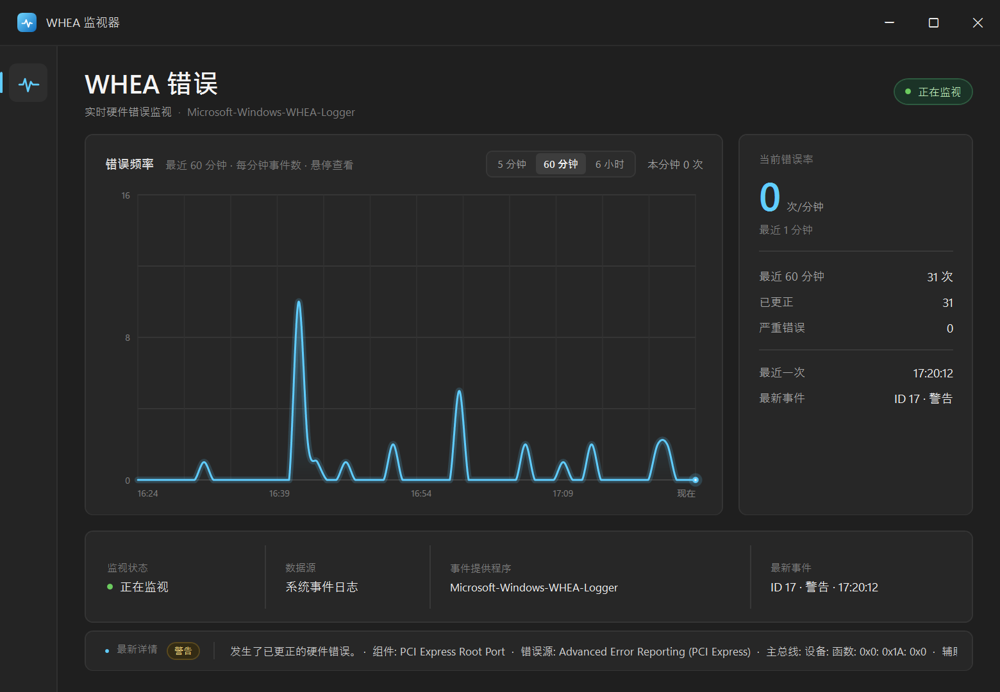

# WHEA 监视器

一个最小化的 Windows 11 桌面工具。界面参考 Windows 11 任务管理器“性能 → CPU”页面，用于实时监视 WHEA 硬件错误并绘制错误频率折线图。



## 运行

双击 `WheaMonitor.exe` 即可，无需安装。

- 系统：Windows 10 / Windows 11
- 运行时：.NET Framework 4.8（Windows 11 已内置）
- 权限：普通用户权限。程序只读取系统事件日志，不写入任何数据

## 数据来源

- 日志：`Windows 日志 → 系统`
- 提供程序：`Microsoft-Windows-WHEA-Logger`
- 方式：启动时读取最近 6 小时的事件，并通过 `EventLogWatcher` 持续接收新事件
- 图表：支持最近 5 分钟（每 5 秒一个点）、最近 60 分钟（每分钟一个点）、最近 6 小时（每 6 分钟一个点），每秒刷新；鼠标悬停可查看该时间段的错误次数，以及该时间段最近一次事件的 ID、级别和时间
- 底部：滚动显示最新一条 WHEA 事件的完整详细信息，内容在显示区域内垂直居中
- 状态：警告级别计为“已更正”，错误/严重级别计为“严重错误”

如果系统安全策略禁止读取系统事件日志，界面右上角会显示“监视不可用”，不会影响系统。

## 构建

需要 Windows 自带的 .NET Framework 4.x 编译器（无需安装 .NET SDK）：

```powershell
powershell -ExecutionPolicy Bypass -File .\build.ps1
```

生成单文件 `WheaMonitor.exe`。界面资源、图标和清单均嵌入 exe。

## 文件

- `Program.cs`：窗口、事件日志监视、状态与统计
- `WheaChart.cs`：无第三方依赖的自绘折线图，包含鼠标悬停读数
- `MainWindow.xaml`：界面布局与样式
- `app.manifest`：Per-Monitor V2 DPI、普通用户权限
- `build.ps1`：编译脚本
